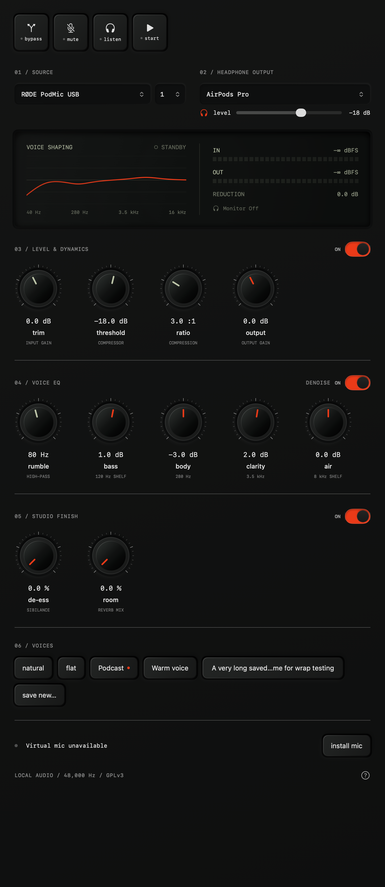

# ClearMic

A native macOS app that shapes your microphone before it reaches Riverside,
your podcast recorder, or a call. Select your interface, adjust the voice,
and choose **ClearMic** as the microphone in the receiving app.

**[Download the latest preview](https://github.com/darrellgardiner-clipflow-vibe/clearmic/releases/latest)** · [Getting started](docs/getting-started.md) · [Contributing](CONTRIBUTING.md)

Free, open-source microphone processing for **macOS 14+**, using a **48 kHz
microphone**. Audio stays on your Mac. No account or subscription.

**Preview status:** existing downloads are ad-hoc signed and not notarized.
They are intended for testers, and macOS may block installation. A signed public
beta is being prepared; hardware compatibility and long-session testing remain
incomplete. Do not disable Gatekeeper or System Integrity Protection.

<details>
<summary>See the ClearMic interface</summary>



Native interface rendered with example devices and saved voices; this is not a live microphone test.

</details>

## Install and use

1. Download the `.pkg` installer from the release above. Quit audio apps and
   install it. Administrator permission is needed for the virtual microphone.
2. Open **ClearMic** from Applications. Follow setup, select your physical
   microphone and channel, then press **Start processing** and allow microphone
   access. If prompted to load the driver, close calls/recordings first: that
   explicit action briefly restarts macOS audio. Restarting your Mac is an alternative.
3. Choose **ClearMic** as the microphone in your recording or call app.
   Keep its speaker/headphone output set to your usual device.

No developer tools are needed to use a downloaded installer. See
[getting started](docs/getting-started.md) for listening, permissions and troubleshooting,
and [uninstalling](docs/getting-started.md#uninstall) to remove it.

## What it does

- Select one hardware input channel, or blend inputs 1 and 2, and send the result equally to both virtual channels.
- Apply input trim, offline speech noise reduction, a high-pass filter, bass/air shelves, low-mid EQ, presence EQ, compression,
  output gain, and a −1 dBFS limiter.
- Compare with the raw signal using Bypass, or silence the output using Mute.
- Show live input/output peaks, compressor gain reduction and an EQ display.
- Hear the processed voice through a selected headphone output with its own level.
- Save device selection and effects locally. Keep processing in the menu bar
  after closing the window.
- Leave the system's default microphone and speakers unchanged.

The first version processes one microphone at 48 kHz. It does not capture
application/system audio, mix several sources, record files, host Audio Unit
plug-ins, or mix application playback. It replaces the microphone-processing
workflow, rather than the full feature sets of Audio Hijack and Loopback.

## Build from source

Developers need macOS 14+, Swift 5.9+ and Xcode tools. See
[CONTRIBUTING.md](CONTRIBUTING.md) for a clean-clone setup and checks.
Local builds are ad-hoc signed; they are not notarized public releases.

```sh
git clone https://github.com/darrellgardiner-clipflow-vibe/clearmic.git
cd clearmic
scripts/check.sh
scripts/package.sh
open build
```

The generated `ClearMic-<version>.pkg` contains the app and driver. Local app
builds target the host architecture; the public release command builds a
universal Apple Silicon/Intel app and driver. Intel execution still needs
verification before advertising compatibility.

With a PodMic USB through XLR, leave its own USB-C cable disconnected. If an
inline phantom-powered booster is in the XLR path, power it according to its
manufacturer's instructions. The Solo's Direct monitor is the raw hardware
signal. To hear ClearMic effects, choose its headphone output in the app, enable
**Listen**, and set the Solo to **USB** monitoring. Listen starts processing
automatically. Use wired headphones to avoid feedback and Bluetooth delay.
Listen starts off at launch and defaults to
−18 dB. It can run before the virtual driver is installed.

Avoid applying a second voice-enhancement/automatic-gain chain in the receiving
app while tuning ClearMic. The Natural preset is a starting point, not a
calibration for every voice. ClearMic does not currently remove electrical whine.

## Build and verify

```sh
swift test                    # Offline DSP and channel-routing behavior
scripts/build-app.sh          # build/ClearMic.app
scripts/build-driver.sh       # build/ClearMic.driver, universal binary
scripts/package.sh            # Installer for both components
```

Build scripts never install a driver, request microphone access, restart
Core Audio, or change a system default. `scripts/check.sh` runs tests and both
builds. See [verification](docs/verification.md) for the live-device checklist.

To inspect the app UI without installing a driver:

```sh
open build/ClearMic.app
```

The app shows driver/setup status until the driver is installed. Processing
starts only when requested. A disconnect or sample-rate change stops processing
with an explanation; reconnect the saved input and press Start again.
Changing the selected source or channel while processing restarts the route
with that selection. A new source resets to Input 1; selecting while stopped
does not start capture. The interface adapts down to 320 points wide and follows
the system light/dark appearance.

Bluetooth microphones running below 48 kHz are currently unsupported. For
example, the connected AirPods Pro microphone reports 24 kHz even though its
headphone output runs at 48 kHz. The source picker marks unsupported rates and
Start explains the limitation. Use a 48 kHz microphone for capture; selecting
AirPods as headphone output is a separate route. Sample-rate conversion is
required before lower-rate microphones can be supported.

## Architecture and licence

SwiftUI controls a C++ real-time DSP callback. A process-private Core Audio
aggregate combines the selected interface with a hidden output device and
enables drift correction. Processed audio flows through the driver's shared
ring into the visible **ClearMic** input. Audio is processed locally without a
cloud service or paid API. The updater contacts GitHub for its feed and release
downloads; it does not send audio.

The virtual driver is a customized build of
[BlackHole](https://github.com/ExistentialAudio/BlackHole), with unmodified source
pinned and attributed in [vendor/BlackHole/UPSTREAM.md](vendor/BlackHole/UPSTREAM.md).
ClearMic is GPL-3.0; see [LICENSE](LICENSE). The app is independent of Rogue Amoeba,
RØDE and Existential Audio. Their proprietary code and visual assets are not used.

Read [architecture](docs/architecture.md) for data ownership and tradeoffs, and
[research](docs/research.md) for the source-based product comparison.

## Remove the prototype

Quit ClearMic and audio apps. Remove `/Applications/ClearMic.app` and only
`/Library/Audio/Plug-Ins/HAL/ClearMic.driver` using Finder with administrator
authentication, then restart the Mac. Leave other HAL drivers in place.
Local preferences belong to the `org.clearmic.app` defaults domain.

## Updates

Sparkle provides **Check for Updates** in the app menu and automatic update
checks. Signed app updates preserve preferences and the installed driver.
Driver changes are a separate administrator step. See [update maintenance](docs/updates.md)
for signing, feed publication and the remaining installed-update test.

## Speech noise reduction

Enable Speech Noise Reduction to reduce background noise while adding gain.
It uses a bundled RNNoise model locally, with no account, network access or
usage fees. Input trim feeds the denoiser; EQ, compression and output gain
follow it. Natural enables cleanup, and Flat disables it for comparison.
Bypass remains dry, and Mute silences both outputs.

Noise reduction adds frame buffering and model lookahead. Bluetooth monitoring
adds its own delay. Compare on/off with your own voice: cleanup can alter
consonants and voice texture and cannot remove all room echo or background speech.
The bundled model runs while processing to keep comparisons responsive. Stop
processing to release the audio route and denoiser. Third-party notices are
in vendor/RNNoise and the application resources.

## Voice EQ

Bass is a 120 Hz low shelf for adding warmth or reducing boom. Body adjusts
280 Hz, Clarity adjusts 3.5 kHz, and Air is an 8 kHz high shelf for brightness.
Bass and Air each range from −12 to +12 dB; both default to zero and preserve
existing gain and noise-reduction settings when updating. Start with small
changes, such as +3 dB Bass, and compare at a similar listening volume.
The LCD curve includes all four bands and the rumble high-pass filter.

## Level, EQ and studio finish

Level & Dynamics groups input trim, compressor threshold/ratio and output
gain. Voice EQ groups the rumble high-pass, bass, body, clarity and air bands.
The source and headphone selectors align at the top, and both processing
sections share a fixed header height. All knob sections use the same column
positions. Listen sits beside the other action buttons; its independent volume
control lives below Headphone Output.

Studio Finish adds optional split-band de-essing to soften sharp S sounds
and a short diffuse mono room reverb. Both start at zero. Its section switch
disables both effects without losing their amounts. For podcasts and
calls, a dry voice is the default; use reverb sparingly when desired. These
controls do not repair clipping, room echo or poor microphone placement.

Choose Save New and enter a name. Saved voices appear as buttons. A clean
voice loads with one click. When a saved voice has been edited, an orange dot
marks it. Click a voice to choose the overwrite target, then click it again to
confirm saving your current sound. Cancel or another processing edit cancels
confirmation. Saving the same name in the Save New dialog updates it. Presets persist locally and contain only
processing settings; loading one keeps the current microphone, channel,
headphone output/level, mute and bypass. Save your current sound before
trying Natural or Flat.

Denoise lives in the Voice EQ header alongside its On/Off switch. Its signal
position remains before EQ; the UI groups the control for convenience.
If the saved source disconnects or stops delivering buffers, Source Lost
and Reconnect appear. Replug the same microphone and choose Reconnect to
reopen it, including when Core Audio assigns a different device ID. Capture
does not resume merely from replugging and never switches to another mic.

The footer shows Connected as the published virtual microphone name while
processing is active, with Off to stop sending audio. On starts it again.
Normal connection guidance is not repeated in a separate status row;
source-loss and error messages remain visible when needed.

First-run setup explains microphone access, driver installation and listening.
The question-mark button reopens setup. Reading the walkthrough does not request
permissions or start recording. See [design](DESIGN.md) for layout and control states.

## iPhone route prototype

The [iOS prototype](ios/README.md) selects and tests a paired Bluetooth microphone
with no receiver, then prepares its audio session before you switch to Apple's
Camera app. It is an experiment in route retention, not an iOS virtual microphone.
Real Camera compatibility is not yet verified. Open `ios/ClearMic.xcodeproj` for
device signing and installation; the macOS build and release flow are separate.
